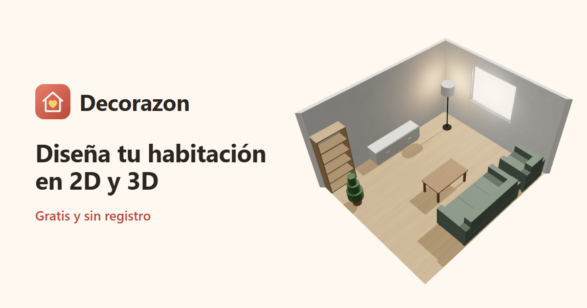

# Decorazon

Planificador de habitaciones en el navegador: dibujas la estancia con sus medidas reales, la amueblas y compruebas, antes de comprar nada, que todo cabe, que puertas y cajones se abren y que queda sitio para pasar. Gratis y sin registro.

**[decorazon.angelgf.com.es](https://decorazon.angelgf.com.es)** · [Cómo funciona](https://decorazon.angelgf.com.es/como-funciona)



## Qué hace

- **Estancia a medida**: dormitorio, salón, cocina, despacho o baño, rectangular o en L, en centímetros; esquinas que se arrastran, paredes que se parten, puertas, ventanas, radiadores, columnas y vigas.
- **Catálogo de casi sesenta tipos** de muebles y electrodomésticos, cada uno con sus medidas, variantes y colores, y el producto de la tienda con su precio.
- **Avisos mientras amueblas**: solapes, muebles que atraviesan la pared o no caben bajo el techo o una viga, puertas y cajones que chocan al abrirse, ventanas y radiadores tapados y pasos de menos de 60 cm.
- **Vista 3D** con texturas, luces y vista desde dentro; los muebles también se mueven ahí.
- **Guardar y compartir**: sin cuenta, en el navegador; con cuenta, hasta 100 diseños en cualquier dispositivo. Enlace de solo lectura, hoja para imprimir o PDF, y descarga del plano, la imagen 3D o el diseño.
- Funciona en el móvil (se instala como app), con teclado y lector de pantalla, y en modo oscuro.

## Stack

| Parte | Tecnología |
|---|---|
| Web (`web/`) | React 19, TypeScript, Vite, Zustand, three.js con react-three-fiber; Vitest y Playwright |
| API (`src/`) | .NET 10, endpoints mínimos, EF Core y PostgreSQL; xUnit y Testcontainers |

La API sigue una arquitectura por capas (Dominio, Aplicación, Infraestructura, Contratos, Api) y `tests/Decorazon.Arquitectura.Tests` vigila que las dependencias solo vayan en el sentido permitido. El núcleo del editor (geometría, catálogo y reglas de los avisos) es TypeScript puro en `web/src/nucleo`, sin React.

## Arrancarlo en local

Hace falta .NET 10, Node 24 y Docker.

```bash
docker compose up -d                       # PostgreSQL en el puerto 5435
cp src/Decorazon.Api/appsettings.Example.json src/Decorazon.Api/appsettings.Development.json
dotnet run --project src/Decorazon.Api     # API en http://localhost:5320 (migra sola en Development)

cd web && npm install
npm run dev -- --port 5321                 # web en http://localhost:5321
```

Sin la API la web funciona igual en modo anónimo (el diseño se guarda en el navegador); la API solo hace falta para las cuentas, los diseños guardados y los enlaces compartidos. En desarrollo los correos no se envían: el enlace aparece en el log de la API.

## Pruebas

```bash
dotnet test Decorazon.slnx                                  # con Docker (Testcontainers)
dotnet test Decorazon.slnx --filter "Categoria!=Integracion" # sin Docker
cd web && npm test                                          # unitarias de la web
cd web && npm run e2e                                       # Playwright sobre el build de producción
cd web && npm run e2e:cuentas                               # cuentas con la API real (necesita docker compose)
```

Más detalle sobre la arquitectura, las decisiones y lo que no es obvio en [`CLAUDE.md`](CLAUDE.md) y en `docs/`.

## Licencia

[MIT](LICENSE).
